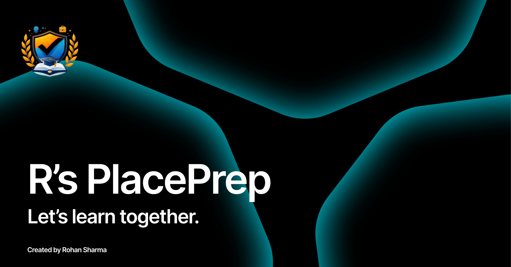

# Welcome to R's PlacePrep

Whether you're preparing for your first placement or looking to strengthen your technical skills, PlacePrep brings study materials, practice questions, coding challenges, and mock examinations together in one platform.

  <a href="https://placeprep.app">
    Start Preparing with PlacePrep →
  </a>

Structured learning resources designed to help you prepare topic by topic or follow a complete subject from start to finish.

- **Companies**: Major hiring companies asked questions.
- **PYQ**: University PYQs with solutions. (currently only BEU papers. If you want to add yours, please [reach out to me](mailto:rohansrma3@gmail.com))
- **Learn**: Structured lessons with examples, visuals, and runnable code. Work through a subject end to end or jump directly to the topic you need.

PlacePrep brings together the things students need during placement season:

 <b>Learn → Practice → Test → Evaluate → Improve</b>

If you're an affiliation/university/college and want to setup placeprep inside your organization, then please [contact me](mailto:rohansrma3@gmail.com). Self-hosting is supported in PlacePrep to take fair examination within a class with NO internet.

  <a href="https://placeprep.app/docs">Visit placeprep docs</a>
  &nbsp;•&nbsp;
  <a href="https://github.com/orgs/rs-placeprep/discussions/1">Discussions</a>

  

